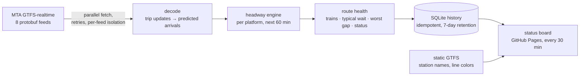

# subwaypulse

[](https://github.com/SnigdhaSrivastva/subwaypulse/actions/workflows/ci.yml)
[](https://github.com/SnigdhaSrivastva/subwaypulse/actions/workflows/pulse.yml)


**▶ Live status board: [snigdhasrivastva.github.io/subwaypulse](https://snigdhasrivastva.github.io/subwaypulse/)** (updated every 30 minutes)

How is the NYC subway running **right now**? subwaypulse reads the MTA's public GTFS-realtime feeds for every line. For each line it computes how many trains are running, the typical wait, and the **worst service gap** a rider faces, with the station where it's happening. It keeps a rolling history and publishes a status board.

## Example snapshot (Thu Oct 1, 3:20 PM ET)

```
770 trains running on 28 lines · 2 lines with service gaps
  F  trains=47  typical=5.8m  worst=28.5m  gaps
  G  trains=28  typical=7.0m  worst=25.0m  gaps
  L  trains=25  typical=5.0m  worst= 9.2m  good
  7  trains=35  typical=4.0m  worst=10.1m  good
  ...
```

All 8 feeds are fetched, decoded and scored in under 6 seconds.

## How it works



**Metric definitions**
- **Platform** = station + direction (for example `A27N`, northbound at 42 St–Port Authority).
- **Headway** = time between consecutive predicted arrivals of the same line at a platform within the next hour. The wait until the first train counts too, so a platform with nothing coming soon shows up as a gap.
- **Typical wait** = median headway across all of the line's platforms. **Worst gap** = the maximum.
- **Status:** `gaps` when the worst gap is at least 20 minutes **and** at least 2.5× the line's typical headway, so lines that normally run infrequently (like the Staten Island Railway) aren't flagged unfairly. Platforms with fewer than 3 predicted arrivals are skipped as too sparse to judge.

## Engineering notes

- **Resilient ingestion:** feeds are fetched in parallel with retries on 429/5xx. A feed that's down or sends malformed protobuf is reported on the board and never stops the others.
- **Idempotent history:** each snapshot is keyed by feed timestamp, so a re-run replaces instead of duplicating. Old rows are pruned after 7 days.
- **Static + real-time join:** station names and official line colors come from the MTA's static GTFS, bundled at build time. Real-time stop ids missing from the static list fall back to a readable code.
- **Zero-infrastructure deployment:** a GitHub Actions cron restores the history from the cache, takes a snapshot, saves it back, and deploys the board to Pages.

## Run it

```bash
pip install -e .
subwaypulse                      # snapshot now -> subwaypulse.sqlite + site/index.html
```

## Tests

`pytest` runs 10 tests (97% coverage) on protobuf feeds built in the tests, so they don't need the network. They cover:
- parsing, ignoring vehicle-only entities
- headway math on even service
- flagging a 31-minute gap with its station
- the look-ahead window and sparse platforms
- limited-data lines
- a failing feed and a corrupt feed in the same snapshot
- store idempotency and pruning
- station names, line colors and HTML escaping on the board
- the CLI end to end

## Tech

Python 3.11 · GTFS-realtime (protobuf) · httpx · SQLite · zoneinfo / tzdata · pytest · ruff · mypy (strict) · GitHub Actions (cron) · GitHub Pages
